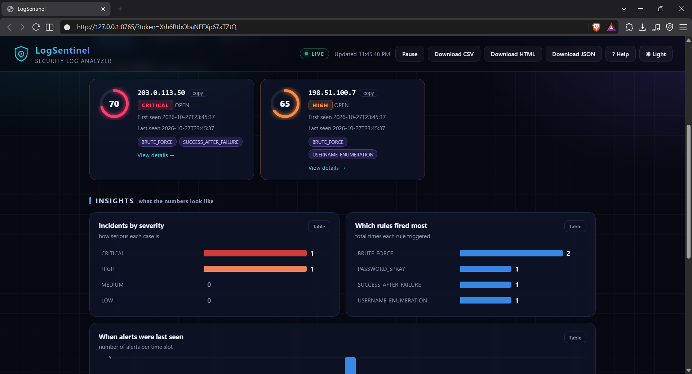
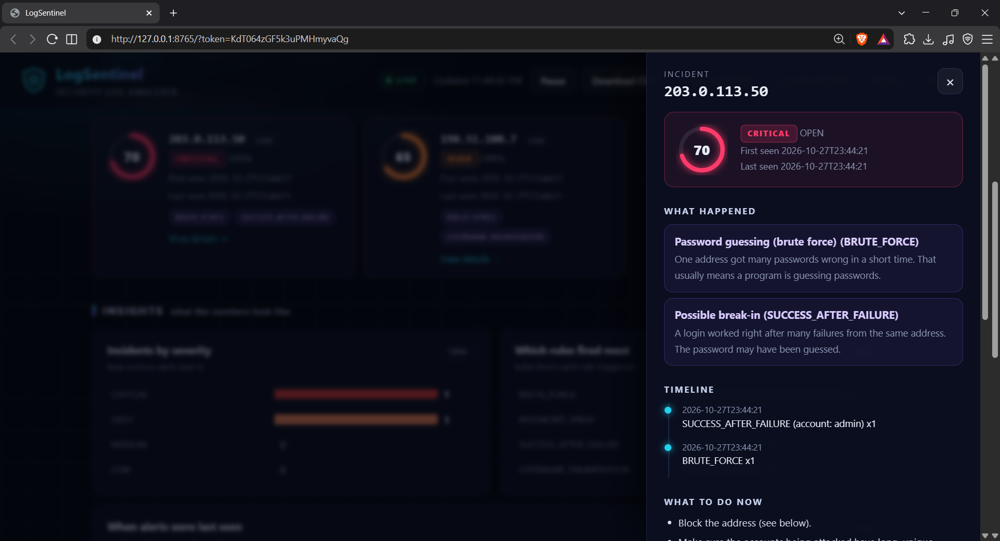

# LogSentinel

A small, local security log analyzer. It reads the **Windows Security log** (or SSH logs and CSV exports), spots suspicious login activity, and shows the result in a dashboard that runs only on your own PC.

> Nothing is uploaded anywhere. Your logs never leave your computer.



<!-- TODO: add screenshots to the docs/ folder with these names -->

## What it detects

| Rule | What it means |
|---|---|
| `BRUTE_FORCE` | One address got many passwords wrong in a short time. |
| `USERNAME_ENUMERATION` | One address tried many different usernames. |
| `SUCCESS_AFTER_FAILURE` | A login worked right after many failures from the same address (possible break-in). |
| `PASSWORD_SPRAY` | Many addresses tried the same account. |
| `ANOMALY` | A sudden spike in failed logins compared with the normal hourly level. |

Alerts for the same address are grouped into an **incident** with a risk score from 0 to 100.

These are threshold-based checks, not proof of an attack. Treat them as leads to investigate. Tune the thresholds in `rules.yaml` for your own environment.

## Features

- Reads the live Windows Security log (events 4625 and 4624). It asks for administrator rights when needed.
- Also reads SSH `auth.log` files, Windows CSV exports and `.evtx` files.
- Local dashboard with a threat level, incidents, charts, search and a plain-language **Help** panel.
- Dark and light themes, and a time range picker (last hour up to 7 days).
- Download reports as **CSV**, **HTML** or **JSON**. CSV output is protected against spreadsheet formula injection.
- Local blocklist, an allowlist and optional AbuseIPDB lookups (only if you set `ABUSEIPDB_API_KEY`).
- A **demo mode** with made-up data, so you can try everything safely.



## Install (Windows)

1. Go to the [Releases](../../releases) page and download `LogSentinel-Setup.exe`.
2. Run it. Windows may show a SmartScreen warning because the installer is not code-signed. Choose **More info**, then **Run anyway**.
3. Open a **new** PowerShell window and run:

```powershell
logsentry start
```

The tool asks for administrator permission, reads your Windows Security log and opens the dashboard in your browser.

Want to look around first? Run `logsentry demo`. It uses made-up data and reads nothing from your PC.

## Install from source

Requires Python 3.9 or newer.

```powershell
git clone https://github.com/Shayan-Chakra/logsentinel.git
cd logsentinel
python -m venv .venv
.\.venv\Scripts\Activate.ps1
pip install -e ".[dev]"
```

Run the tests:

```powershell
python -m pytest -q
```

## Commands

| Command | What it does |
|---|---|
| `logsentry start` | Scan the Windows Security log and open the dashboard. Options: `--hours 24`, `--rules rules.yaml`, `--no-admin`, `--no-dashboard`. |
| `logsentry demo` | Open the dashboard with made-up sample data. |
| `logsentry dashboard` | Open the dashboard for alerts already saved. Options: `--port`, `--no-browser`. |
| `logsentry analyze FILE` | Analyze a log file (SSH log, Windows CSV or `.evtx`). |
| `logsentry monitor FILE` | Follow an SSH log file and alert as new lines arrive. |
| `logsentry history` | Show saved alerts. |
| `logsentry incidents` | Show saved incidents with risk scores. |
| `logsentry console` | Interactive text console. |

Try it on the included samples:

```powershell
logsentry analyze examples\auth.log
logsentry analyze examples\windows_sample.csv
```

All IP addresses in `examples\` are documentation-only addresses (`203.0.113.x`, `198.51.100.x`, `192.0.2.x`).

## Configuration

Edit `rules.yaml` to change the thresholds and the allowlist. If you override a rule, include all of its fields. LogSentinel looks for `rules.yaml` in the current folder first, then in its data folder (`%LOCALAPPDATA%\LogSentinel`).

## Privacy and security

- The dashboard listens on `127.0.0.1` only, so other computers can't reach it.
- Every request needs a random secret token. The link with the token is shown in the LogSentinel window.
- Requests with an unexpected Host header are refused.
- LogSentinel only reads logs and reports. It never changes your firewall, accounts or settings. The "block" command in the dashboard is only copied to your clipboard for you to run yourself.
- Alerts are stored in a local SQLite database in `%LOCALAPPDATA%\LogSentinel`.

## Limitations

- It is a heuristic detector, so expect some false positives and some misses. Check thresholds against your own log volume.
- Live Windows scanning needs administrator rights and PowerShell.
- `monitor` follows SSH logs only and checks fewer rules than `analyze`.
- SSH log lines have no year, so the current year is assumed.
- Local failed logins (sign-in screen, lock screen) are shown as `LOCAL`. They are not outside addresses.

## Project layout

```
src/logsentinel/   the application
tests/             automated tests
examples/          sample logs
rules.yaml         default rules
installer.iss      Inno Setup script for the Windows installer
logsentry.spec     PyInstaller build recipe
```

## Build the installer

```powershell
pip install pyinstaller
pyinstaller logsentry.spec
```

Then open `installer.iss` in [Inno Setup](https://jrsoftware.org/isinfo.php) and compile it.

## License

MIT. See [LICENSE](LICENSE).
